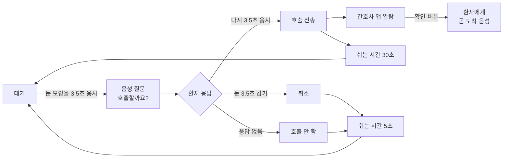
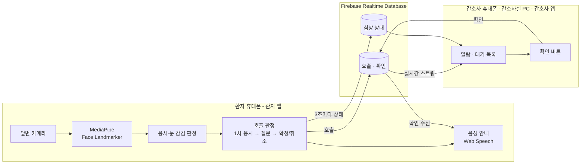

# OpticCall :eyes:
비접촉식 시선 추적 간호 호출 시스템

> **바로 써 보기** — 웹앱(PWA)이라 설치 없이 주소만 열면 된다
> * 환자 앱 (휴대폰): **https://kyu-sw.github.io/KY_SW_PSY/webapp/patient/**
> * 간호사 앱 (휴대폰 · PC): **https://kyu-sw.github.io/KY_SW_PSY/webapp/nurse/**
>
> 두 앱의 **병동 코드**를 같게 맞추면 서로 연결된다 (기본 `ward1`). 휴대폰에서는 홈 화면에 추가하면 앱처럼 전체 화면으로 열린다 (아래 [기기별 여는 방법](#기기별-여는-방법)).

# 프로젝트 소개
**OpticCall**은 수술 직후 거동이 불편한 환자 및 운동 장애 환자가 손이나 몸을 움직이지 않고도 의료진을 호출할 수 있도록 만든 비접촉식 시선 추적 기반 호출 시스템이다.
침대 옆에 둔 휴대폰이 환자의 시선과 눈 감김을 인식하고, 환자가 휴대폰을 바라봐 호출을 확정하면 간호사의 휴대폰이나 간호사실 PC에 알람이 울린다.

두 앱은 앱스토어에서 받는 네이티브 앱이 아니라 **웹앱(PWA, Progressive Web App)** 이다. 브라우저로 주소를 열어 쓰고, 홈 화면에 추가하면 주소창 없이 앱처럼 열린다.

| 앱 | 기기 | 하는 일 |
| --- | --- | --- |
| **환자 앱** | 침대 옆에 고정한 **휴대폰** | 앞면 카메라로 시선·눈 감김 인식 → 음성으로 확인 질문 → 호출 전송, 간호사 확인을 음성으로 알려 줌 |
| **간호사 앱** | 간호사 **휴대폰** 또는 간호사실 **PC** (여러 대 동시 가능) | 침상 상태 보기, 호출 알람(소리·진동·알림), 확인 버튼으로 환자에게 "곧 갑니다" 전달, 오늘 기록 |

## 기기별 여는 방법
| 기기 | 브라우저 | 홈 화면에 추가 |
| --- | --- | --- |
| 아이폰 · 아이패드 | **Safari** | 공유 버튼 → **홈 화면에 추가** |
| 안드로이드 | **Chrome** (삼성 인터넷도 가능) | 오른쪽 위 **⋮** → **홈 화면에 추가** (또는 **앱 설치**) |
| PC (간호사 앱) | Chrome · Edge | 주소창 오른쪽 설치 아이콘 (선택) |

* 처음 열 때 **카메라 권한**(환자 앱)과 **알림 권한**(간호사 앱)을 허용한다. 카메라 때문에 `https://` 주소로 열어야 한다.
* 간호사 앱 알람의 **진동은 안드로이드에서만** 된다 (아이폰 Safari는 웹의 진동을 지원하지 않아 소리·화면으로 알림).
* 음성은 기기의 한국어 음성을 쓴다. 안드로이드에서 소리가 안 나면 설정 → 텍스트 음성 변환에서 한국어를 받는다.
* 업데이트는 따로 받을 필요 없이 다시 열면 바로 반영된다.

## 웹앱으로 만든 이유와 한계
* **이유**: 설치 없이 링크만으로 쓸 수 있고(병원 기기에 앱 설치가 어려워도 사용 가능), 코드 하나로 아이폰·안드로이드·PC에서 동작하며, 고치면 모든 기기에 바로 반영된다. 카메라 영상은 휴대폰 안에서만 분석한다.
* **한계**: 간호사 앱 화면이 꺼져 있거나 앱을 닫으면 알람을 받을 수 없어, 화면을 켜 둔 채로 쓴다 (앱이 화면 꺼짐을 막음). 실제 도입 시에는 간호사 앱을 네이티브 앱으로 만들어 화면이 꺼져 있어도 푸시 알림을 받게 하는 것이 다음 단계다.

# 프로젝트 목표
* **비접촉식 호출 환경 제공**: 호출 버튼을 누르기 어려운 환자도 눈만 움직여 의료진을 호출할 수 있도록 한다.
* **저비용 시스템 구축**: 전용 장비 없이 **환자용 휴대폰 한 대**와 간호사가 가진 휴대폰·PC만으로 동작하고, 별도 모델 학습 없이 실시간 분석한다.
* **오호출 방지**: 1차 응시 → 음성 확인 질문 → 2차 응시의 이중 확인 절차와 쿨다운으로 무의식적인 시선 이동이나 중복 호출을 막는다.
* **신속한 알림과 응답 확인**: 호출 확정 즉시 간호사 앱에 알람이 울리고, 간호사가 확인하면 환자에게 음성으로 알려 준다.
* **사용자 맞춤 설정**: 환자 상태에 맞게 응시·눈 감김 시간과 호출 후 쉬는 시간을 개별 설정한다.

# 사용 방법
1. **침상 등록 (간호사 앱)**: 간호사 앱 [침상 관리]에서 침상과 환자를 등록하면 **4자리 연결 코드**가 생긴다. 환자 휴대폰 설정에 그 코드를 넣으면 그 침상으로 연결된다 (로그인 대신, 간호사가 알려 준 코드로 침상과 휴대폰을 짝짓는 방식).
2. **휴대폰 놓기**: 환자 앱 휴대폰을 얼굴 옆쪽 위(정면에서 30° 정도, 40~60cm)에 고정한다. 평소 천장을 볼 때는 반응하지 않고, 고개를 돌리지 않고 **눈만 돌려** 휴대폰을 볼 때만 반응한다. 세로·가로 모두 쓸 수 있다.
3. **눈 맞추기 (처음 한 번)**: 환자 앱 [눈 맞추기] → 화면의 눈 모양을 바라보기 → 눈 감기. 환자마다 시선 기준을 맞춘다.
4. **호출 대기 시작**: 환자가 눈 모양을 3.5초 바라보면 "호출할까요?" 질문 → 다시 바라보면 **호출**, 눈을 감으면 **취소**.
5. **간호사 앱**: 휴대폰이나 간호사실 PC 브라우저에서 열고, 이름과 병동 코드를 넣은 뒤 [알람 켜고 시작]. 호출이 오면 전체 화면 알람이 울리고, [확인 · 지금 갈게요]를 누르면 환자 휴대폰에서 "간호사가 호출을 확인했습니다. 곧 도착합니다."가 나온다. 한 사람이 확인하면 다른 기기의 알람도 꺼진다.



# 세부 기능
**환자 앱 (휴대폰)**
* **시선·눈 감김 인식**: MediaPipe Face Landmarker(웹 버전)로 얼굴 랜드마크 478개를 휴대폰 안에서 바로 분석. 홍채 위치·고개 각도로 휴대폰 응시 여부를, EAR(Eye Aspect Ratio)과 눈 깜빡임 점수로 눈 감김을 판정. **카메라 영상은 휴대폰 밖으로 나가지 않는다.**
* **눈 맞추기(개인 보정)**: 바라보기·눈 감기 표본으로 환자별 시선 기준과 허용 범위를 자동 계산. 하지 않으면 공통 기준으로 동작.
* **음성 확인 질문**: 화면을 보기 어려운 환자를 위해 질문·결과를 한국어 음성으로 안내 (설정한 초가 문구에 자동 반영).
* **쿨다운**: 호출 후 30초(0~120초 조절), 취소·응답 없음 후 5초 동안 다시 묻지 않고, 시선을 한 번 뗀 뒤에야 다시 센다. 5분 안에 다시 부르면 **재호출**로 표시.
* **침상 연결**: 간호사 앱의 4자리 연결 코드로 침상에 연결. 간호사가 환자를 바꾸면 자동으로 새 환자로 바뀌고(응시 시간·눈 맞추기는 환자마다 따로), 코드를 새로 만들면 연결이 끊겼다고 알려 줌. 같은 침상을 다른 휴대폰이 쓰면 경고.
* **설정 화면**: 연결 코드, 병동 코드, 1차 응시·확정 응시·취소 눈 감기 시간(2~10초, 0.5초 단위), 호출 후 쉬는 시간, 음성 속도, 카메라 선택, 인식 수치 보기.
* **화면**: 세로는 위쪽, 가로는 렌즈 쪽 가장자리에 응시 표적을 두어 표적을 보면 곧 카메라를 보게 함. 진행 링으로 남은 시간 표시, 화면 꺼짐 방지.

**간호사 앱 (휴대폰 · PC)**
* **어느 기기든**: 휴대폰은 들고 다니며, 간호사실 PC는 큰 화면으로 병동 전체를 본다. 여러 기기를 동시에 켜 둘 수 있고, 누가 확인하면 모든 기기에 반영된다.
* **침상 관리**: 침상·환자 등록, 환자 바꾸기(입원), 퇴원(빈 침상), 삭제, 연결 코드 새로 만들기. 변경은 오늘 기록에 남는다. 등록 안 된 침상에서 온 호출도 '미등록'으로 표시해 알람을 울린다.
* **침상 현황**: 연결된 침상마다 대기 중 / 호출 중 / 확인함 / 연결 끊김 표시 (환자 앱이 3초마다 상태 전송).
* **호출 알람**: 전체 화면 알람 + 소리 + 진동(안드로이드) + 알림. 확인 안 된 호출이 있으면 계속 울림.
* **동시 호출 대기 목록**: 여러 침상이 동시에 부르면 모두 표시. **재호출 먼저**, 그다음 **오래 기다린 순서**로 정렬하고 각각 확인 버튼. 재호출이 있으면 더 급한 소리.
* **응답 확인 전달**: 확인한 간호사 이름이 환자 앱으로 전달되어 음성 안내.
* **오늘 기록**: 호출·확인 시각, 지금 호출 수, 오늘 호출 수, 평균 확인 시간.

# 시스템 아키텍처


| 계층 | 구성 | 역할 |
| --- | --- | --- |
| **Input** | 휴대폰 앞면 카메라 (getUserMedia) | 환자 얼굴 영상 (휴대폰 밖으로 보내지 않음) |
| **Vision** | MediaPipe Face Landmarker (WASM·GPU) → 특징값 계산 | 홍채 위치·고개 각도·EAR로 응시·눈 감김 판정 |
| **Decision** | 호출 상태 기계 (대기 → 질문 → 응답 대기 → 쿨다운) | 호출·취소·응답 없음 이벤트 생성 |
| **Link** | Firebase Realtime Database (REST + 실시간 스트림) | 호출·확인·침상 상태·침상 등록을 병동 코드별로 주고받음 |
| **Output** | Web Speech 음성 · 간호사 앱 알람(소리·진동·알림) | 환자 안내, 의료진 알림 (휴대폰·PC) |

# Use Case Diagram


# 기존 호출 방식과 비교
| | 버튼식 너스콜 | 호흡·빨대 스위치 등 보조 스위치 | 전용 시선 추적 장치 | **OpticCall** |
| --- | --- | --- | --- | --- |
| 손·몸 움직임 필요 | 필요 | 입·호흡 등 일부 필요 | 불필요 | **불필요 (눈만)** |
| 필요한 장비 | 병실 설비 | 전용 스위치 | 전용 카메라·단말 | **환자용 휴대폰 1대 + 간호사 휴대폰·PC** |
| 오호출 방지 | 버튼 누름 자체 | 스위치 조작 | 장치별 설정 | **응시 → 음성 질문 → 재응시 이중 확인** |
| 간호사 응답 확인 | 병실에 와야 앎 | 병실에 와야 앎 | 장치별 | **확인 즉시 음성으로 알려 줌** |
| 환자별 맞춤 | 없음 | 스위치 위치 조정 | 보정 필요 | **눈 맞추기 + 응시 시간 설정** |

# 기술 스택 및 개발 환경
* **웹앱(PWA):** HTML · CSS · JavaScript (ES 모듈, 빌드 없음), 홈 화면 추가 — 환자 앱은 휴대폰(Safari · Chrome), 간호사 앱은 휴대폰·PC 브라우저
* **비전 분석:** MediaPipe Tasks Vision — Face Landmarker (브라우저 WASM)
* **음성 안내:** Web Speech API (한국어)
* **앱 연결:** Firebase Realtime Database (REST · 실시간 스트림), 같은 브라우저 시연용 BroadcastChannel
* **배포:** GitHub Pages (https)
* **첫 버전(노트북):** Python, OpenCV, DroidCam, Windows SAPI, Telegram Bot API
* **개발 환경 · 버전 관리:** Visual Studio Code, GitHub

# 시험
* **판정 로직 자동 확인**: `webapp/test/` 페이지에서 응시·눈 감김 판정, 눈 맞추기 계산, 호출 흐름, 쿨다운 등 **38개 항목**을 브라우저에서 바로 확인 (파이썬 버전과 같은 시험 경우 포함). 파이썬 버전은 `test_*.py`.
* **사용자 시험**: 한 사람당 호출 3번 · 취소 2번 · 60초 딴 데 보기(질문·호출이 없어야 성공)를 하고 성공률과 걸린 시간을 기록한다 (`scenario_test.py`). 결과는 통합시험결과서에 정리한다.

# 프로젝트 구조
```text
OpticCall/
├── webapp/                  # 웹앱(PWA) (GitHub Pages로 배포)
│   ├── patient/             # 환자 앱 (휴대폰): 홈 · 시선 추적 · 눈 맞추기 · 설정
│   ├── nurse/               # 간호사 앱 (휴대폰 · PC): 침상 관리 · 침상 현황 · 호출 알람 · 대기 목록 · 확인 · 오늘 기록
│   ├── core/
│   │   ├── camera.js        # 앞면 카메라 + MediaPipe 얼굴 랜드마크
│   │   ├── features.js      # 응시 · 눈 감김 판정, 눈 맞추기 계산
│   │   ├── controller.js    # 1차 응시 → 확인 질문 → 확정/취소, 쿨다운
│   │   ├── voice.js         # 음성 안내
│   │   ├── link.js          # Firebase · BroadcastChannel 연결
│   │   └── store.js         # 환자별 설정 저장
│   ├── models/              # MediaPipe 얼굴 모델
│   ├── icons/
│   └── test/                # 판정 로직 확인 페이지
│
│   (아래는 첫 버전: 노트북 + DroidCam + Telegram)
├── main.py                  # 전체 실행 (시작 점검 · 호출 판정 · 음성 · 알림 · 호출 기록)
├── settings_app.py          # 설정 화면 (카메라 · 알림 · 환자별 응시 시간)
├── app.py · build_exe.py    # 실행 파일(.exe) 시작점 · 만들기
├── config.py                # 기본 응시·눈 감김 시간, EAR 임계치 등 설정값
├── profiles/                # 사용자별 설정 (users.json)
├── input/camera_stream.py   # DroidCam 영상 수신 (OpenCV)
├── vision/                  # MediaPipe 랜드마크 추출 · 응시 · EAR 계산
├── decision/                # 호출 판정 (call_controller.py)
├── output/                  # Windows 음성 · Telegram 알림
├── telegram_setup.py        # 알림 수신자 확인 · 테스트 알림
├── scenario_test.py         # 사용자 시험 도구와 결과표
├── docs/                    # 첫 버전 아키텍처 · 유스케이스 그림
├── requirements.txt
└── .env.example
```

# 실행 방법 (개발자용)
**웹앱을 노트북에서 띄우기**
```bash
python -m http.server 8765 --directory webapp
```
Chrome에서 `http://localhost:8765/patient/`(환자), `http://localhost:8765/nurse/`(간호사), `http://localhost:8765/test/`(판정 로직 확인).
같은 브라우저의 탭끼리도 연결되어 노트북 한 대로 시연할 수 있다. 휴대폰에서는 카메라 때문에 `https://` 주소(위의 GitHub Pages 주소)가 필요하다.

# 첫 버전: 노트북 + DroidCam + Telegram
처음에는 휴대폰을 DroidCam으로 PC 웹캠처럼 연결하고, PC에서 파이썬으로 판정한 뒤 Telegram으로 알림을 보냈다.
판정 로직(응시·EAR·호출 흐름)은 이 버전에서 만들고 시험한 뒤 휴대폰 앱(`webapp/core`)으로 그대로 옮겼다.


**1. 설치** (Windows, Python 3.13)
```bash
python -m venv .venv
.venv\Scripts\activate
pip install -r requirements.txt
```
`models/face_landmarker.task`(MediaPipe 얼굴 모델)가 있어야 한다.

**2. 설정 파일 만들기** — `.env.example`을 복사해 `.env`로 이름을 바꾸고 값을 채운다. (`.env`는 GitHub에 올라가지 않는다)

| 항목 | 내용 |
| --- | --- |
| `CAMERA_SOURCE` | DroidCam 앱에 보이는 IP (예: `10.22.9.230`), USB·웹캠이면 장치 번호 (예: `1`) |
| `TELEGRAM_BOT_TOKEN` | BotFather에게 받은 봇 토큰 |
| `TELEGRAM_CHAT_IDS` | 알림 받을 사람의 Chat ID (쉼표로 여러 명), `python telegram_setup.py`로 확인 |
| `BED_LABEL` | 알림에 표시할 침상 이름 |

알림 받을 사람은 Telegram에서 봇을 찾아 **시작**을 누른 뒤, `python telegram_setup.py --test`로 테스트 알림을 받아 본다.

설정 화면을 쓰면 `.env`를 직접 고치지 않아도 된다: `python settings_app.py` → 값 입력 → **[저장하고 시작]**

**3. 실행**
```bash
python main.py
```
시작할 때 카메라 · 사용자 응시 시간 · 텔레그램 알림을 점검하고, "옵틱콜을 시작합니다" 음성이 나오면 사용할 수 있다. 종료는 영상 창에서 `q` 또는 `ESC`.

| 옵션 | 내용 |
| --- | --- |
| `--user 이름` | 그 사람의 응시 시간(`profiles/users.json`)·개인 보정값 사용 (없으면 공통 기준) |
| `--camera IP` | 이번 실행만 다른 카메라 사용 |
| `--no-window` | 영상 창 없이 실행 (종료: Ctrl+C) |
| `--no-notify` | 텔레그램 알림 없이 실행 (연습·시연용) |

사용자별 응시 시간 설정: `python -m profiles.profile_manager --user 이름 --set first_gaze_sec=3`

호출 기록은 `logs/call_history.csv`에 쌓인다 (질문 · 호출 · 취소 · 알림 전송 결과와 걸린 시간).

**시험하기** (한 사람당 약 5분)
```bash
python scenario_test.py --name 시험자A --note 안경
```
음성 안내에 따라 호출 3번(보고 → 질문 → 다시 보기), 취소 2번(보고 → 질문 → 눈 감기), 60초 딴 데 보기(질문·호출이 없어야 성공)를 차례로 한다.
`--notify`를 붙이면 실제 Telegram 알림('[시험]' 표시)과 '확인' 버튼까지 시간을 잰다. 결과는 `results/`에 저장되고(GitHub에는 올리지 않음), 전체 결과표는 `python scenario_test.py --report`.

**실행 파일(.exe) 만들기**
```bash
pip install pyinstaller
python build_exe.py
```
`dist/OpticCall/` 폴더를 통째로 복사하면 파이썬이 없는 PC에서도 `OpticCall.exe`를 더블클릭해 설정 화면 → 실행할 수 있다. (`.env`, `profiles/`, `logs/`는 exe 옆에 만들어진다)

# 참고 자료
* Google, *MediaPipe Face Landmarker* — https://ai.google.dev/edge/mediapipe/solutions/vision/face_landmarker
* T. Soukupová, J. Čech, "Real-Time Eye Blink Detection using Facial Landmarks", *21st Computer Vision Winter Workshop*, 2016 (EAR)
* Firebase, *Realtime Database REST API · Streaming* — https://firebase.google.com/docs/reference/rest/database
* MDN, *Web Speech API* — https://developer.mozilla.org/docs/Web/API/Web_Speech_API
* MDN, *Screen Wake Lock API* — https://developer.mozilla.org/docs/Web/API/Screen_Wake_Lock_API
