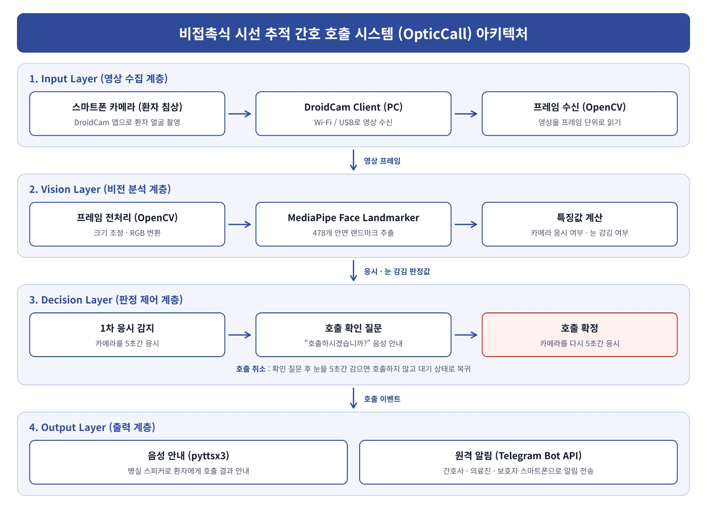

# OpticCall :eyes:
비접촉식 시선 추적 간호 호출 시스템  
#  프로젝트 소개
**OpticCall**은 수술 직후 거동이 불편한 환자 및 운동 장애 환자가 손이나 몸을 움직이지 않고도 의료진을 호출할 수 있도록 기획된 비접촉식 시선 추적 기반 호출 시스템  
환자의 실시간 시선과 눈 깜빡임 패턴을 감지하여, 신체 움직임 없이도 즉각적으로 간호사·의료진·보호자를 호출할 수 있다.
# 프로젝트 목표
* **비접촉식 호출 환경 제공**: 호출 버튼을 누르기 어려운 환자도 카메라를 응시하는 것만으로 의료진을 호출할 수 있도록 한다.
* **저비용 시스템 구축**: 별도의 웹캠이나 전용 장비 없이 스마트폰 카메라(DroidCam)와 일반 PC만으로 동작하며, 별도 모델 학습 없이 실시간 분석이 가능하도록 한다.
* **오호출 방지**: 1차 응시 → 음성 확인 질문 → 2차 응시로 이어지는 이중 확인 절차와 쿨다운 타이머를 통해 무의식적인 시선 이동이나 중복 호출을 차단한다.
* **신속한 원격 알림**: 호출 확정 즉시 간호사·의료진·보호자의 스마트폰으로 알림을 동시에 전송하여 대응 시간을 단축한다.
# 세부 기능
* **카메라 스트리밍 연동**: 침상에 거치한 스마트폰 카메라 영상을 DroidCam을 통해 Wi-Fi / USB로 PC에 실시간 전송하고, OpenCV로 프레임 단위 수신
* **안면 및 시선·깜빡임 추적**: MediaPipe Face Landmarker로 478개 안면 랜드마크를 추출하여 홍채 위치 기반 카메라 응시 여부와 EAR(Eye Aspect Ratio) 기반 눈 감김 여부 판정
* **1차 응시 감지**: 환자가 카메라를 약 5초간 응시하면 Dwell Time 타이머가 누적되어 호출 확인 단계로 진입
* **음성 확인 질문**: pyttsx3로 병실 스피커를 통해 "호출하시겠습니까?" 및 "호출을 원하시면 다시 5초간 카메라를 응시하시고, 원하지 않으시면 눈을 5초간 감아주세요"를 음성 안내 (화면을 볼 수 없는 환자를 고려)
* **호출 확정 / 취소**: 다시 5초간 응시하면 호출 확정, 눈을 5초간 감으면 호출하지 않고 대기 상태로 복귀하며 결과를 음성으로 안내
* **원격 알림 발송**: Telegram Bot API를 통해 간호사·의료진·보호자 스마트폰으로 호출 알림을 동시에 푸시 전송 (수신자는 Telegram 앱만 설치)
* **오호출 방지 쿨다운**: 호출 직후 일정 시간 동안 연속 중복 호출을 차단하는 쿨다운 타이머 관리
  
# 시스템 아키텍처
[](https://github.com/KYU-SW/KY_SW_PSY/issues/2)

| 계층 | 구성 | 역할 |
| --- | --- | --- |
| **Input Layer** | 스마트폰 카메라 → DroidCam Client → OpenCV | 환자 얼굴 영상 수집 및 프레임 수신 |
| **Vision Layer** | 프레임 전처리 → MediaPipe Face Landmarker → 특징값 계산 | 카메라 응시 여부 · 눈 감김 여부 판정 |
| **Decision Layer** | 1차 응시 감지 → 호출 확인 질문 → 호출 확정 / 취소 | 호출 이벤트 생성 및 제어 |
| **Output Layer** | pyttsx3 음성 안내 · Telegram Bot API 원격 알림 | 환자 안내 및 의료진·보호자 알림 |

# Use Case Diagram
[https://github.com/KYU-SW/KY_SW_PSY/issues/2](https://github.com/KYU-SW/KY_SW_PSY/issues/1)

# 기술 스택 및 개발 환경
* **개발 언어:** Python

* **개발 환경:** Visual Studio Code

* **영상 입력:** DroidCam (스마트폰 앱 + PC 클라이언트), OpenCV

* **비전 분석:** MediaPipe Face Landmarker

* **음성 안내:** pyttsx3 (오프라인 TTS)

* **원격 알림:** Telegram Bot API

* **버전 관리:** GitHub

# 프로젝트 구조
```text
OpticCall/
├── main.py                  # 전체 실행 루프
├── config.py                # 응시·눈 감김 시간, EAR 임계치, 쿨다운 등 설정값
│
├── input/
│   └── camera_stream.py     # DroidCam 영상 수신 (OpenCV)
│
├── vision/
│   ├── face_landmarker.py   # MediaPipe 안면 랜드마크 추출
│   └── features.py          # 카메라 응시 여부 · EAR 계산
│
├── decision/
│   └── call_controller.py   # 1차 응시 → 확인 질문 → 확정/취소, 쿨다운
│
├── output/
│   ├── tts.py               # pyttsx3 음성 안내
│   └── notifier.py          # Telegram Bot 알림 전송
│
├── docs/
│   ├── architecture.webp
│   └── usecase.png
│
├── requirements.txt
├── .env.example             # Telegram Bot 토큰 · 수신자 Chat ID
└── README.md
```
